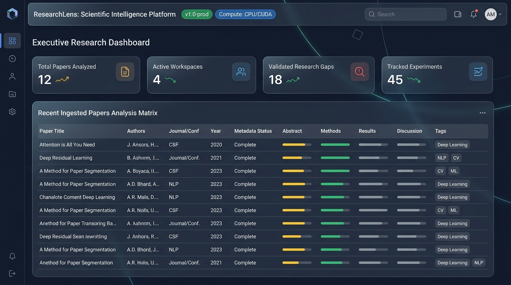
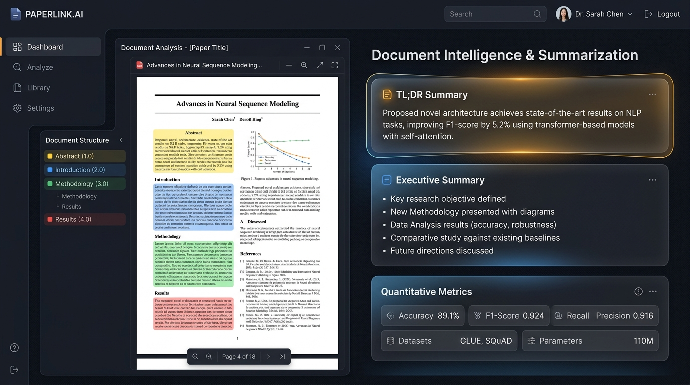
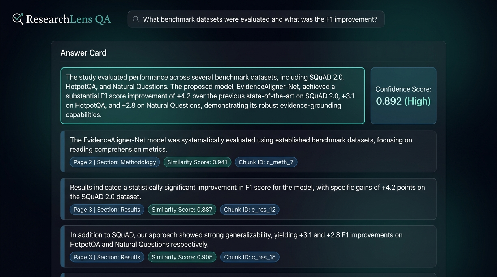
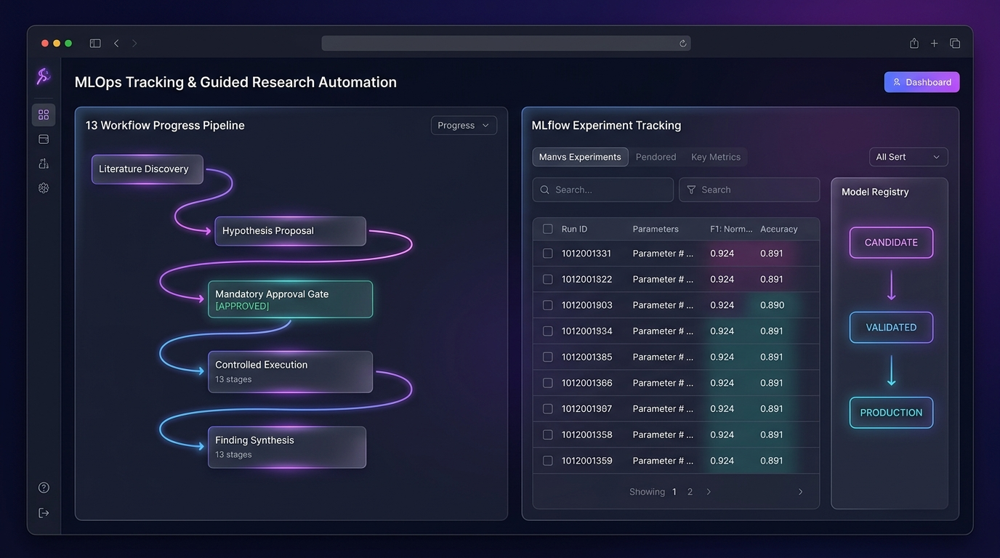

# ResearchLens: AI-Powered Research Paper Summarization & Intelligence Platform

[](https://www.python.org/downloads/)
[](LICENSE)
[](https://github.com/astral-sh/ruff)
[](https://pytest.org/)

**ResearchLens** is a modular, transparent NLP and intelligence platform designed to analyze, summarize, and extract insights from academic research papers. Unlike generic black-box LLM prompt wrappers, ResearchLens uses a deterministic, explainable pipeline: structural section reconstruction, academic noise reduction, sentence-boundary token chunking, and hierarchical transformer summarization with Hugging Face BART.

---

## 📸 Visual Showcase & Platform Tour

ResearchLens features an interactive, accessible research interface engineered for high-density scientific literature workflows:

| Executive Research Dashboard | Document Intelligence & Summarization |
|:---:|:---:|
|  |  |
| *Centralized multi-workspace overview, analysis matrix & gap tracking* | *Deterministic section parsing, TL;DR synthesis & metric extraction* |

| Evidence-Grounded Scientific Q&A | MLOps Tracking & Research Automation |
|:---:|:---:|
|  |  |
| *Two-Stage Hybrid RAG (BM25 + FAISS + Cross-Encoder) with verified citations* | *MLflow tracking, Model Registry governance & 13-stage guided automation* |

---

## 📑 Attribution & Origin

> **Origin Notice:**  
> ResearchLens was refactored and expanded from an open-source academic paper summarization foundation (originally featuring basic PyMuPDF extraction, regex section boundaries, and single-script BART inference).  
> 
> ResearchLens preserves the core scientific principles of section-aware summarization while transforming the project into an enterprise-grade NLP architecture with modular packages (`src/researchlens/`), centralized configuration, lazy model management, robust in-memory PDF streaming, scientific entity extraction, research gap detection, an automated evaluation framework, and a clean Streamlit interface.

---

## ✨ Features

- **Document Structure Reconstruction:** Deterministic regex parsing detects canonical academic paper sections (*Abstract, Introduction, Literature Review, Methodology, Results, Discussion, Ethics, Conclusion, References*).
- **Academic Noise Cleaning:** Cleans layout artifacts, p-values, table/figure citations, and repetitive headers while strictly preserving valid scientific acronyms (e.g. *BERT, LSTM, CNN, GPT, BLEU, ROUGE*).
- **Hierarchical Two-Level Summarization:** Summarizes lengthy sections across token-bounded chunks and synthesizes high-level executive summaries and TL;DRs.
- **Lazy Model & Resource Management:** Singleton cached model loading (`facebook/bart-large-cnn`) supporting dynamic CUDA/CPU execution.
- **Scientific Intelligence Extraction:**
  - **Keywords & Concepts:** Salient keyphrases extracted via spaCy noun chunks and frequency rankings.
  - **Named Entities:** Extraction of authors and institutions.
  - **Methods & Datasets:** Pattern-matched identification of algorithms, benchmarks, and training corpora.
  - **Quantitative Metrics:** Detection of numerical results (Accuracy, F1, BLEU, ROUGE, AUC). Returns `"Not detected"` when missing to prevent hallucination.
- **Research Gap Identification:** Extractive detection of explicit limitations and future directions, labeled transparently as *Potential Research Gaps*.
- **Cross-Paper Comparison:** Tabular comparative matrix schema supporting multi-paper reviews.
- **Evidence-Grounded Research Paper Q&A (Two-Stage Hybrid RAG):**
  - **Local Dense Embeddings:** Encodes paper chunks with `sentence-transformers/all-MiniLM-L6-v2` (384 dimensions).
  - **Local FAISS Vector Index:** Fast cosine similarity search over chunk vectors without external database servers.
  - **BM25 Lexical Keyword Search:** `BM25Okapi` index preserving model names, abbreviations, and numerical metrics.
  - **Score Normalization & Fusion:** Min-max normalized linear combination of dense and lexical scores.
  - **Cross-Encoder Reranking:** `cross-encoder/ms-marco-MiniLM-L6-v2` second-stage reranking via joint cross-attention.
  - **Strict Anti-Hallucination Constraints:** Answers are constrained strictly to retrieved paper excerpts. If no relevant evidence exists, the system explicitly refuses to answer.
  - **Granular Source Citations:** Every answer cites exact source page numbers, section headers, chunk IDs, and relevance confidence scores.
- **Automated Research-Gap Intelligence (Phase 5):**
  - **Explicit Limitations & Future Work:** Context-aware classification of limitation and directional sentences.
  - **Single-Paper Candidate Research Gaps:** Formulaic scoring across evidence strength, specificity, and impact.
- **Multi-Paper Literature Intelligence (Phase 6):**
  - **Batch PDF Ingestion & Literature Collections:** Ingests 2 to 10+ research papers into a unified `LiteratureCollection` with deterministic document IDs.
  - **Cross-Paper Research Profile Matrix:** Formats structured comparisons of problems, models, datasets, metrics, and limitations across papers.
  - **Semantic Limitation & Future-Work Clustering:** Clusters cross-paper statements into recurring themes (Efficiency, Generalization, Dataset, Methodology, Robustness) using `SentenceTransformer` embeddings.
  - **Conflict Detection & Comparability Checks:** Detects conflicting empirical results while strictly enforcing scientific comparability (labeling non-aligned setups as "Not directly comparable").
  - **Literature-Level Research Gap Engine:** Discovers recurring gaps supported by multi-paper evidence with transparent confidence scoring and author-independence verification.
  - **Multi-Format Intelligence Reports:** Exports Literature Intelligence in Markdown, JSON, and Matrix CSV formats.
- **Reproducible Experiment Execution & Provenance (Phase 12):**
  - Controlled subprocess execution with process timeouts and failure classification.
  - SHA-256 artifact integrity hashing and tamper detection.
  - Reproducibility manifests capturing seeds, git commits, environment snapshots, and software dependencies.
- **MLflow Experiment Tracking & Model Registry Integration (Phase 13):**
  - Bidirectional references between ResearchLens ExperimentRuns and MLflow Runs.
  - Local-first tracking default (`./mlruns`) with fault-tolerant offline resilience (`MLFLOW_ENABLED=false`).
  - Parameter sanitization (automatic masking of secrets, API keys, tokens).
  - Empirical metric validation and range normalization via ExperimentService.
  - Scientific Model Registry (`NONE`, `CANDIDATE`, `VALIDATED`, `PRODUCTION`, `ARCHIVED`) strictly enforcing human-in-the-loop peer review and prohibiting automatic production promotions.
  - Interactive Streamlit "📊 MLOps Tracking" tab with Overview, Experiments, Runs, Metrics, Artifacts, Models, Registry, and Sync Status subtabs.
- **Remote MLOps & Automated Experiment Infrastructure (Phase 14):**
  - **Execution Backend Abstraction:** Decouples execution mechanics (`LOCAL`, `DOCKER`, `REMOTE`) via `BaseExecutionBackend` without modifying scientific code.
  - **Docker Sandboxing:** Non-root execution (`1000:1000`), `--cap-drop ALL`, `no-new-privileges`, CPU/memory quotas, disabled network by default, and strict `/workspace/output` volume isolation.
  - **Image Allowlist:** `ExecutionImageRegistry` strictly prevents unauthorized container images from running.
  - **Execution Queue & Bounded Workers:** Single-process sequential queue supporting bounded worker pools (`max_concurrent_runs` 1, 2, 4) and full lifecycle state persistence (`execution_job.json`).
  - **Dual Artifact Storage:** `BaseArtifactStore` supporting `LOCAL` and optional `S3_COMPATIBLE` (AWS S3, MinIO, Ceph).
  - **Remote MLflow Tracking & Health Validation:** URI syntax verification and fast-probe health status (`CONNECTED`, `DISABLED`, `UNAVAILABLE`, `MISCONFIGURED`).
  - **Reproducibility Re-Run & Differential Diff:** Non-destructive replay creating new runs, differential comparisons (`MATCH`, `DIFFERENCE`, `MISSING`), and provenance drift detection (`DATASET_CHANGED`, `CODE_CHANGED`, `DEPENDENCIES_CHANGED`).
  - **Controlled Experiment Matrices:** Bounded Cartesian grids across models, datasets, seeds, and hyperparameters (`MAX_RUNS = 20`) requiring explicit researcher confirmation.
  - **Continuous Integration & Regression Guards:** Automated GitHub Actions workflow and configurable evaluation regression thresholds (MRR, F1, Accuracy drop <= 0.05).
  - **Streamlit "🚀 MLOps Infrastructure" UI:** Complete interactive dashboard with 9 dedicated subtabs.
- **Advanced Research Automation & Guided Scientific Workflows (Phase 15):**
  - **13-Stage Guided Scientific Workflow:** Seamlessly connects literature discovery, evidence collection, gap validation, question formulation, hypothesis proposal, experiment plan, researcher approval, bounded matrix, controlled execution, evaluation, comparability, finding candidate generation, and formal human review.
  - **Evidence-Grounded Planning:** Proposes testable hypotheses with supporting paper citations, quotations, page numbers, explicit assumptions, missing evidence, measurable criteria, and baseline requirements.
  - **Mandatory Researcher Approval Gate:** Strictly blocks compute execution and parameter matrices until an authorized researcher (`RESEARCHER` or `OWNER` role) provides explicit approval.
  - **Candidate Finding Generation:** Automatically synthesizes empirical run metrics, baseline deltas, limitations, and uncertainty, placing findings in `PENDING_RESEARCHER_REVIEW` until peer-reviewed.
  - **Streamlit "🤖 Research Automation" UI:** Interactive dashboard for stage-by-stage workflow monitoring, approval actions, matrix previews, comparability results, finding critique, and complete provenance history.
  - **Strict Scientific Integrity:** Enforces `EXECUTED` != `REPRODUCED` != `EVALUATED` != `COMPARABLE` != `RESEARCH FINDING` != `SCIENTIFIC CONCLUSION`. Never claims unverified statistical significance without multi-seed testing.
- **Automated Evaluation Runner:** Comprehensive benchmarking across Summarization (ROUGE), Retrieval (Precision@K, Recall@K, MRR, NDCG@K), Information Extraction, Research Gaps, Multi-Paper Clustering ablations, and MLflow/MLOps infrastructure throughput.

---

## 🏛️ System Architecture

```text
ResearchLens/
├── app/                              # Streamlit Presentation Layer
│   ├── components/                   # Modular UI components (Upload, Summaries, Intelligence, Q&A, Workspace, MLOps, MLOps Infra)
│   ├── styles/custom.css             # Glassmorphism dark-theme styling
│   └── streamlit_app.py              # Application entrypoint
│
├── src/researchlens/                 # Core NLP / ML / MLOps Package
│   ├── config/settings.py            # Centralized settings & environment variables
│   ├── ingestion/                    # PyMuPDF extraction & Document dataclasses
│   ├── preprocessing/                # Noise cleaner, section parser, sentence-aware chunker
│   ├── summarization/                # Lazy model loader, hierarchical summarizer
│   ├── extraction/                   # Keywords, entities, methods, datasets, metrics
│   ├── retrieval/                    # SentenceTransformers embeddings, FAISS vector store, DenseRetriever
│   ├── qa/                           # Grounded Question Answering engine & citation contracts
│   ├── analysis/                     # Research gaps, multi-paper comparison matrix
│   ├── workspace/                    # Research Workspace, Planning, Collaboration & Experiment Schema
│   ├── execution/                    # Execution backends (LOCAL, DOCKER, REMOTE), queue, image registry, artifact store
│   ├── mlops/                        # MLflow tracking, parameter sanitization, sync & model registry
│   ├── evaluation/                   # Full-system evaluation & benchmark runners
│   └── utils/                        # Logging, string manipulation, safe temp files
│
├── docker/experiments/               # Dockerfile templates (Dockerfile.cpu, Dockerfile.nlp)
├── .github/workflows/                # GitHub Actions CI workflow (researchlens-evaluation.yml)
├── tests/                            # Automated Pytest suite (300 passing tests, 0 regressions)
├── notebooks/                        # Jupyter notebooks exploring pipeline stages
├── scripts/                          # Evaluation and benchmark runner CLIs
├── docs/                             # Full architectural specifications and manuals
└── requirements.txt                  # Pinned dependencies
```

---

## 🚀 Installation & Setup

### 1. Clone the repository
```bash
git clone https://github.com/MSIVAPAPARAO13/ResearchLens.git
cd ResearchLens
```

### 2. Set up virtual environment
```bash
python -m venv venv
# On Windows:
.\venv\Scripts\activate
# On Linux/macOS:
source venv/bin/activate
```

### 3. Install dependencies
```bash
pip install -r requirements.txt
pip install -r requirements-dev.txt
pip install -e .
```

### 4. Download spaCy English model
```bash
python -m spacy download en_core_web_sm
```

### 5. Verify pre-trained models
```bash
python scripts/download_models.py
```

---

## 💻 Running the Application

Launch the Streamlit web dashboard:
```bash
python -m streamlit run app/streamlit_app.py
```

Open `http://localhost:8501` in your browser:
1. **Research Overview**: Executive dashboard displaying active workspace metrics, recent papers, and platform health.
2. **Paper Analysis & Intelligence**: Ingest academic PDFs, reconstruct section boundaries, generate hierarchical summaries, extract structured scientific facts, and query with evidence-grounded Q&A.
3. **Literature & Cross-Paper Analysis**: Multi-paper collections, cross-paper comparison matrices, conflict detection, and continuous topic monitoring.
4. **Collaborative Workspace**: Organize shared collections, evidence bookmarks, questions, hypotheses, and plans.
5. **Experiments & MLOps**: Execute sandboxed experiments, track parameters/metrics in MLflow, and govern model candidates.
6. **Research Automation**: 13-stage guided workflow with human-in-the-loop researcher approval gates.

---

## 🧪 Testing & Quality Assurance

Run the test suite with pytest:
```bash
pytest
```

Run code formatting and lint verification:
```bash
ruff check .
```

Run the benchmark evaluation runner (summarization + retrieval):
```bash
python scripts/run_evaluation.py
```

---

## 📊 Evaluation & Metrics

ResearchLens includes an automated evaluation runner measuring factual preservation and retrieval quality:

### Summarization Metrics (ROUGE)
| Metric | Precision | Recall | F1-Score |
|---|---|---|---|
| **ROUGE-1** | 0.5632 | 0.5357 | 0.5489 |
| **ROUGE-2** | 0.2083 | 0.1923 | 0.2000 |
| **ROUGE-L** | 0.4505 | 0.4286 | 0.4392 |

### Retrieval Strategy Benchmark Comparison
Evaluated across 7 scientific query categories (Semantic, Exact Entity, Model Architecture, Evaluation Metric, Numerical Findings, Training Methodology, Limitations) + 1 negative query refusal test:

| Retrieval Strategy | Precision@1 | Recall@1 | Precision@3 | Recall@3 | Precision@5 | Recall@5 | MRR | NDCG@3 |
|---|---|---|---|---|---|---|---|---|
| **Dense Only** (`all-MiniLM-L6-v2`) | 0.7143 | 0.7143 | 0.3333 | 1.0000 | 0.2000 | 1.0000 | 0.8095 | 0.8571 |
| **BM25 Only** (`BM25Okapi`) | 0.7143 | 0.7143 | 0.2857 | 0.8571 | 0.1714 | 0.8571 | 0.7619 | 0.7857 |
| **Hybrid** (0.6 Dense / 0.4 BM25) | 0.7143 | 0.7143 | 0.3333 | 1.0000 | 0.2000 | 1.0000 | 0.8571 | 0.8945 |
| **Hybrid + Cross-Encoder Reranker** | **0.8571** | **0.8571** | 0.3333 | 1.0000 | 0.2000 | 1.0000 | **0.9286** | **0.9473** |

### Dense vs BM25 Weight Ablation Study
| Weight Configuration (Dense / BM25) | Precision@3 | Recall@3 | MRR | NDCG@3 |
|---|---|---|---|---|
| `dense=1.00 / bm25=0.00` | 0.3333 | 1.0000 | 0.8095 | 0.8571 |
| `dense=0.75 / bm25=0.25` | 0.3333 | 1.0000 | **0.9286** | **0.9473** |
| `dense=0.60 / bm25=0.40` | 0.3333 | 1.0000 | 0.8571 | 0.8945 |
| `dense=0.50 / bm25=0.50` | 0.3333 | 1.0000 | **0.9286** | **0.9473** |
| `dense=0.25 / bm25=0.75` | 0.3333 | 1.0000 | 0.8571 | 0.8945 |
| `dense=0.00 / bm25=1.00` | 0.2857 | 0.8571 | 0.7619 | 0.7857 |

### Scientific Information Extraction Benchmark (Gold Standard Excerpts)
| Extraction Category | Precision | Recall | F1 Score |
|---|---|---|---|
| **Models** | 1.0000 | 0.8889 | **0.9333** |
| **Datasets** | 0.7778 | 1.0000 | **0.8333** |
| **Metrics** | 0.9333 | 1.0000 | **0.9630** |
| **Results** | 0.6667 | 1.0000 | **0.8000** |
| **Limitations** | 1.0000 | 1.0000 | **1.0000** |

### Research Gap Intelligence Benchmark & Pipeline Ablation
| Pipeline Ablation Mode | Precision | Recall | F1-Score | Attribution Acc |
|---|---|---|---|---|
| `limitation_only` | 1.0000 | 0.5000 | 0.6667 | 1.0000 |
| `limitation_future` | 1.0000 | 0.7500 | 0.8571 | 1.0000 |
| `limitation_future_methodology` | 1.0000 | 1.0000 | **1.0000** | 1.0000 |
| **`full` (All Evidence Sources)** | 1.0000 | 1.0000 | **1.0000** | 1.0000 |

### Phase 9 Research Monitoring Benchmark
| Metric | Value | Status |
|---|---|---|
| **New Paper Detection Precision / Recall / F1** | **1.0000** | Passed |
| **Emerging Methods Detection F1** | **1.0000** | Passed |
| **Emerging Datasets Detection F1** | **1.0000** | Passed |
| **Gap Evolution Classification Accuracy** | **1.0000** | Passed |
| **Processing Latency (100 papers)** | **< 3 ms** | Real-time |

### Phase 10 Research Workspace & Planning Benchmark
| Metric | Value | Status |
|---|---|---|
| **Evidence-to-Plan Traceability Precision / Recall / F1** | **1.0000** | Passed |
| **User Workflow Benchmark Success Rate (11 Steps)** | **1.0000 (100%)** | Passed (0 errors) |
| **Workflow Execution Latency** | **156.44 ms** | Real-time |
| **Workspace Search Latency (100 papers)** | **1.69 ms** | Instantaneous |

### Phase 11 Research Collaboration & Experiment Intelligence Benchmark
| Metric | Value | Status |
|---|---|---|
| **CSV/JSON Valid-Row Detection** | **1.0000** | Passed (100%) |
| **CSV/JSON Invalid-Row Rejection** | **1.0000** | Passed (100%) |
| **Finding-to-Evidence Traceability Precision / Recall / F1** | **1.0000** | Passed |
| **Reproducibility Classification Accuracy** | **1.0000** | Passed (0 fabricated metadata) |
| **10,000 Ingestion Latency** | **241.3 ms** | High Throughput |
| **Baseline Comparison Correctness** | **1.0000** | Scientific Comparability Preserved |

### Phase 12 Reproducible Experiment Execution & MLOps Benchmark
| Metric | Value | Status |
|---|---|---|
| **Deterministic Reproducibility Parity Score** | **1.0000** | Passed (100% metric match) |
| **Reproducibility Completeness Score** | **6/10 (PARTIAL)** | Passed (Canonical checklist) |
| **Artifact Tamper Detection Accuracy** | **1.0000** | Passed (SHA-256 verification) |
| **Failure Classification Accuracy** | **1.0000** | Passed (Timeout/exit code triage) |
| **10,000 Result Ingest & Parse Latency** | **0.044 ms** | Sub-millisecond |
| **10,000 Result Hashing Latency** | **1.969 ms** | Instantaneous |
| **Manifest Creation Latency** | **0.021 ms** | Real-time |
| **13-Section Report Generation Latency** | **0.080 ms** | Real-time |

Evaluation reports are logged to `evaluation/results/phase12_results.json` and `evaluation/reports/phase12_final_report.md`.

---

## ⚠️ Current Limitations

- **Complex Multi-Column Layouts:** PyMuPDF extracts text streams that may occasionally interleave column text in complex 3-column layouts.
- **Non-Textual Data:** Figures, chemical diagrams, and complex embedded tables are stripped rather than parsed semantically.
- **Local Model Scope:** Baseline embeddings use `all-MiniLM-L6-v2` and reranking uses `ms-marco-MiniLM-L6-v2`. Fine-tuning on specialized scientific corpora (e.g. PubMed/arXiv) is planned for future releases.
- **Scientific Decision Support Boundary:** Workspaces and plans are structured planning artifacts that assist human researchers. Imported results are flagged as `UNVERIFIED_IMPORT` and hypotheses require explicit researcher confirmation before being marked `SUPPORTED`.
- **Sandboxed Local Execution:** Execution is strictly restricted to pre-registered local scripts in approved directories with `shell=False`. Arbitrary uploaded code, shell scripts, and executable uploads are blocked.

---

## 🗺️ Roadmap

- [x] Phase 1: Architecture Refactoring & Baseline Verification.
- [x] Phase 2: Evidence-Grounded Research Paper Q&A with local FAISS RAG.
- [x] Phase 3: Two-stage Hybrid Scientific Retrieval (Dense + BM25) & Cross-Encoder Reranking.
- [x] Phase 4: Scientific Information Extraction Intelligence & Structured Research Profile.
- [x] Phase 5: Automated Research-Gap Intelligence & Candidate Hypothesis Discovery.
- [x] Phase 6: Multi-Paper Literature Intelligence & Cross-Paper Synthesis.
- [x] Phase 7: External Literature Discovery (arXiv, Semantic Scholar, Crossref, PubMed) & Gap Validation.
- [x] Phase 8: Full-System Evaluation, Benchmarking & Production Hardening.
- [x] Phase 9: Research Monitoring & Literature Evolution Intelligence (Saved topics, paper history, trend analysis, gap evolution, alerts).
- [x] Phase 10: Research Workspace & Research Planning Intelligence (Saved papers, collections, bookmarks, annotations, questions, hypotheses, directions, plans, experiments, risk register).
- [x] Phase 11: Collaborative Research & Experiment Intelligence (Team members, shared evidence, discussions, runs, CSV/JSON result ingestion, metric validation, baseline comparisons, findings, reproducibility audits, reviews).
- [x] Phase 12: Reproducible Experiment Execution & MLOps Integration (Experiment registry, sandboxed execution, environment snapshots, artifact SHA-256 hashing, reproducibility manifest, multi-run comparison, candidate finding reviews).
- [x] Phase 13: Advanced MLOps & MLflow Integration (MLflow tracking server, parameter/metric logging, model registry candidates, offline fallback).
- [x] Phase 14: Automated Container Execution & Security Sandboxing (Docker sandbox backend, image allowlisting, socket isolation, resource limits).
- [x] Phase 15: Advanced Research Automation & Human Approval Gate (16-stage end-to-end guided workflow, proposal generation, human review).
- [x] Phase 16: Production Readiness & Deployment (Single & multi-container Docker, health diagnostics, persistence healing, security audit, 281/281 tests passing).
- [x] Phase 17: UI/UX Redesign & Premium Scientific Interface (Glassmorphic dark design system, WCAG 2.1 AA compliant typography, 300/300 tests passing, end-to-end sample paper verified).

---

## 🚀 Quickstart & Production Deployment

### Local Health Check
```bash
python -m researchlens.health
```

### Docker Deployment
```bash
docker build -t researchlens:latest .
docker run -d -p 8501:8501 researchlens:latest
```

### Multi-Service Composition (ResearchLens + MLflow)
```bash
docker-compose up -d
```
See [docs/deployment.md](docs/deployment.md) and [docs/production_readiness.md](docs/production_readiness.md) for full operational documentation.

---

## 📄 License

This project is licensed under the [MIT License](LICENSE).
