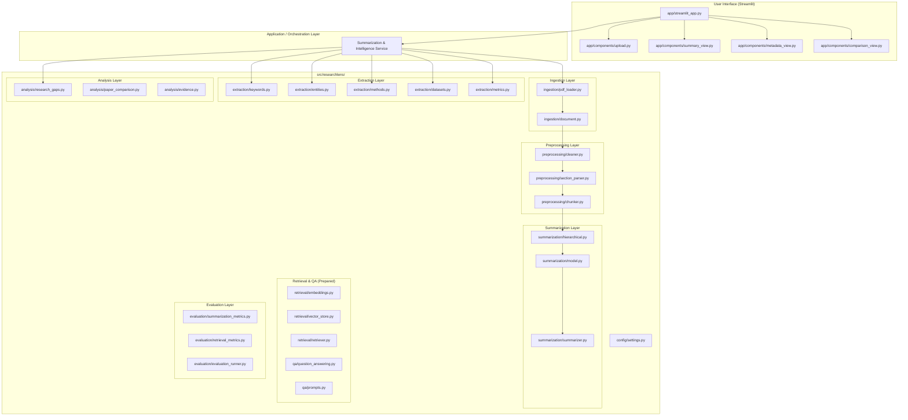
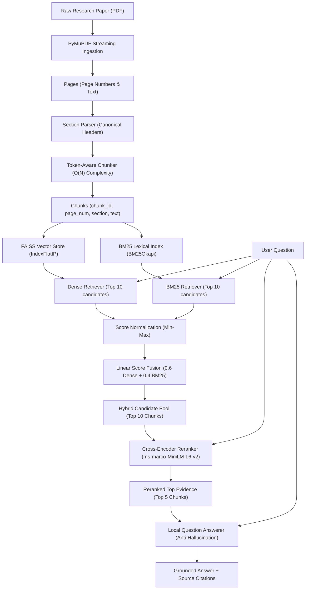
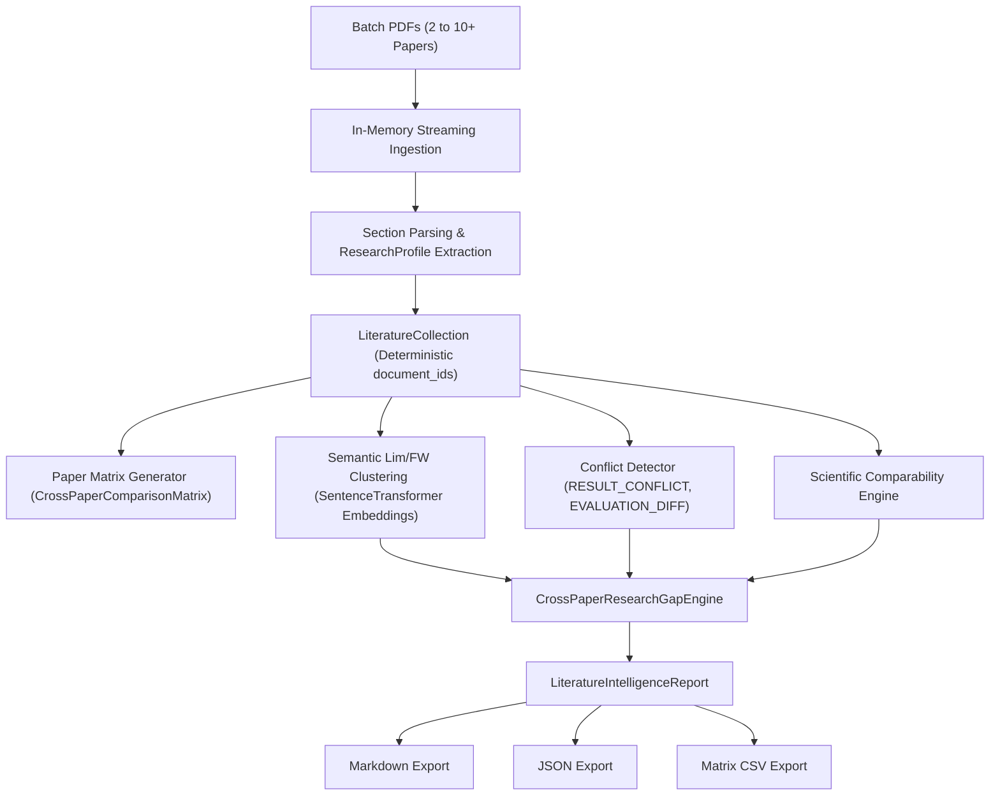
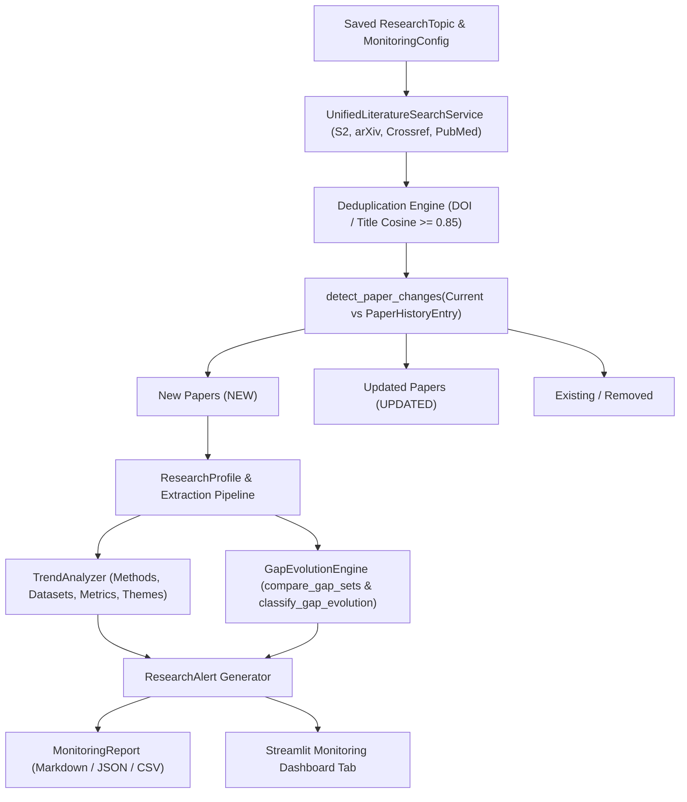
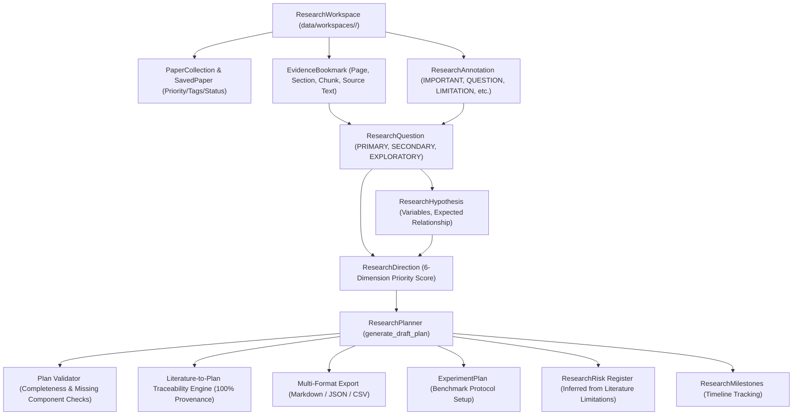
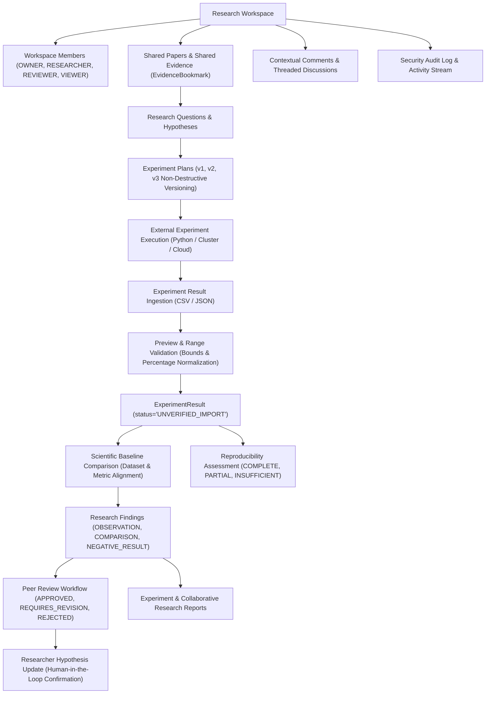
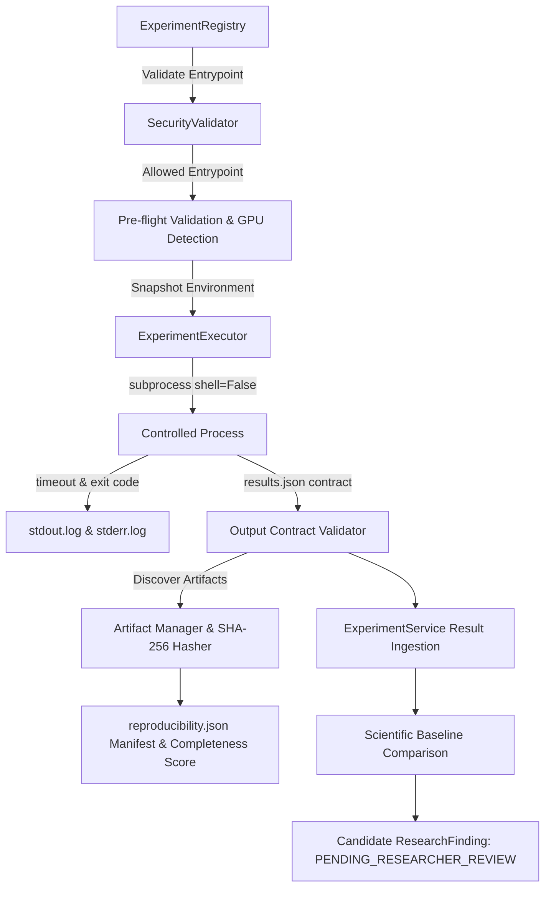
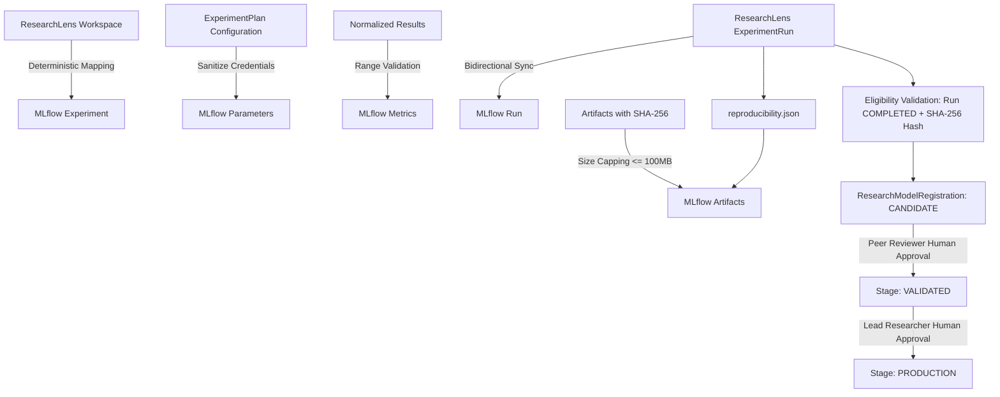
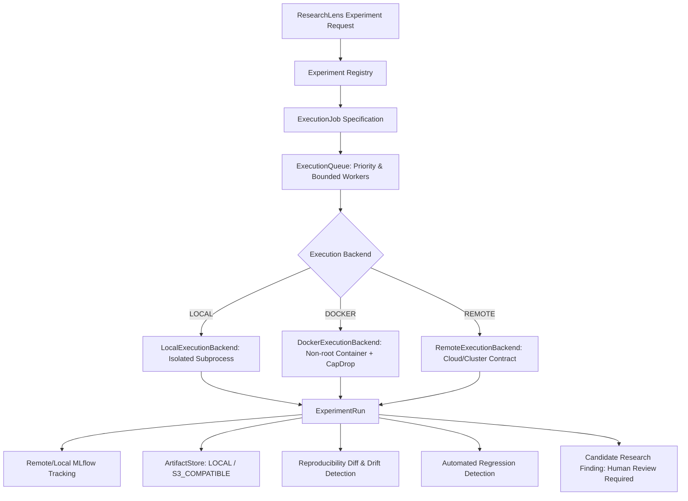
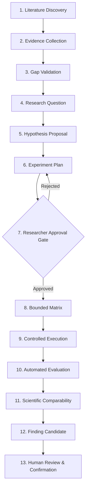

# ResearchLens Architecture Documentation

## 1. System Overview

**ResearchLens** is a modular, AI-powered research paper summarization and intelligence platform. It transforms dense, unstructured academic PDFs into structured, explainable, and hierarchical insights while maintaining strict factual boundaries.

Unlike opaque end-to-end prompting, ResearchLens implements a transparent, multi-stage pipeline:
1. **Ingestion:** Robust extraction preserving document structure, metadata, and page numbers.
2. **Preprocessing:** Noise reduction, explainable regex-based section detection, and sentence-boundary preserving token chunking.
3. **Summarization:** Cached BART-large transformer models operating in a two-tier hierarchical architecture (chunk-level condensation followed by section-level synthesis).
4. **Information Extraction:** Rule- and entity-based identification of authors, methods, datasets, metrics, and quantitative findings.
5. **Research Gap Analysis:** Heuristic extraction of explicit limitations and potential research directions.
6. **Evaluation Framework:** Standard ROUGE (1, 2, L) metric computation and retrieval benchmark contracts.

---

## 2. Target Architecture Diagram

---

## 3. Module Responsibilities

### `src/researchlens/config/`
- **`settings.py`**: Central source of truth for runtime configurations, paths, tokenizer limits, chunk sizes, beam parameters, and device resolution (CPU / CUDA). Supports environment variable overrides without hardcoding secrets.

### `src/researchlens/ingestion/`
- **`document.py`**: Strongly typed data representations (`Document`, `Page`, `Section`, `Chunk`, `DocumentMetadata`).
- **`pdf_loader.py`**: Robust PyMuPDF wrapper supporting file paths, binary streams, and temporary file handles. Guarantees file resource closure (`doc.close()`) and page text extraction with page numbers.

### `src/researchlens/preprocessing/`
- **`cleaner.py`**: Academic noise reduction. Cleans citation artifacts, p-values, table/figure references while explicitly protecting valid scientific acronyms (e.g. BERT, LSTM, GPT, CNN).
- **`section_parser.py`**: Explainable, pattern-based academic section classifier mapping noisy text lines to canonical sections (Abstract, Introduction, Literature Review, Methodology, Results, Discussion, Ethics, Conclusion, References).
- **`chunker.py`**: Sentence-aware, token-bounded chunker with configurable overlap and chunk metadata. Eliminates repeated quadratic tokenization.

### `src/researchlens/summarization/`
- **`model.py`**: Thread-safe lazy loading and memory caching for `transformers.BartForConditionalGeneration` and `BartTokenizer`. Implements CPU/CUDA detection.
- **`summarizer.py`**: High-level summarization interface (`summarize_text`, `summarize_section`, `summarize_document`, `generate_tldr`, `generate_executive_summary`).
- **`hierarchical.py`**: Multi-chunk hierarchical summarizer that condenses chunk-level summaries into coherent section summaries.

### `src/researchlens/extraction/`
- **`schema.py`**: Strong typed dataclasses (`ExtractedItem`, `QuantitativeResultItem`, `BaselineComparison`, `ResearchProfile`) preserving verbatim evidence, 1-indexed page number, canonical section name, chunk ID, heuristic confidence, and extraction method.
- **`metadata.py`**: Extraction of paper title, authors, organizations/affiliations, publication year, and author keywords.
- **`problem_objective.py`**: Extraction of research problem, research objective, explicit research questions (`RQ1`), and hypotheses (`H1`).
- **`methods.py`**: Method, model, and algorithm extraction combining POS tagging, NER, noun phrase analysis, and known scientific model patterns.
- **`datasets.py`**: Benchmark dataset extraction with sample size, data modality, split ratios, and source provenance.
- **`experimental_setup.py`**: Hyperparameter, data split, training setup, and hardware configuration extraction.
- **`metrics.py`**: Extraction of metric names, quantitative results (`Metric = Value`), and baseline comparative items with difference calculation.
- **`contributions.py`**: Identification of explicit paper contributions.
- **`gaps_limitations.py`**: Extraction of limitations, weaknesses, and explicit future work directions.
- **`validator.py`**: Entity deduplication, numerical consistency validation, and profile completeness validation.
- **`pipeline.py`**: `ExtractionPipeline` orchestrator coordinating all scientific extractors into a single `ResearchProfile`.

### `src/researchlens/analysis/`
- **`literature_collection.py`**: `LiteratureDocument` and `LiteratureCollection` dataclasses managing multi-paper collections with deterministic SHA-256 document hashing.
- **`paper_matrix.py`**: `PaperComparisonMatrix` generator building method, dataset, metric, baseline, and result comparison tables.
- **`comparability.py`**: Scientific comparability logic enforcing dataset/task alignment before comparing numerical results (`"Comparable"` vs. `"Not directly comparable"`).
- **`conflict_detector.py`**: `CrossPaperConflict` detection identifying empirical result contradictions (`RESULT_CONFLICT`) and evaluation differences (`EVALUATION_DIFFERENCE`).
- **`semantic_clustering.py`**: `LimitationCluster` grouping limitations and future work across papers into recurring themes using `SentenceTransformer` cosine similarity.
- **`cross_paper_gap_engine.py`**: `CrossPaperResearchGapEngine` formulating literature-level research gaps with cross-paper recurrence scoring and author independence checks.
- **`external_provider.py`**: Abstract `ExternalLiteratureProvider` interface contract preparing for future external discovery (Phase 7 readiness).
- **`literature_report.py`**: `LiteratureIntelligenceReport` aggregator supporting Markdown, JSON, and CSV matrix exports.
- **`research_gap_schema.py`**: Strongly typed `ResearchGap` and `ResearchHypothesis` schemas with provenance, confidence scores, and multi-paper fields.
- **`gap_engine.py`**: `ResearchGapEngine` analyzing single-paper `ResearchProfile` inputs.
- **`gap_scorer.py`**: Transparent multi-attribute heuristic scoring and confidence calibration.
- **`research_gap_report.py`**: Single-paper `ResearchGapReport` aggregator.
- **`paper_comparison.py`**: Multi-paper comparison schema and comparison matrix aggregator.
- **`evidence.py`**: Evidence provenance tracking linking summaries and claims back to page/chunk sources.

### `src/researchlens/retrieval/` & `qa/`
- **`embeddings.py`**: Local `SentenceTransformerEmbeddings` utilizing `sentence-transformers/all-MiniLM-L6-v2` with lazy loading, device selection, and L2 normalization.
- **`vector_store.py`**: Local `FAISSVectorStore` executing normalized inner product (exact cosine similarity) with metadata payload indexing.
- **`bm25.py`**: Local lexical search via `BM25Okapi` with scientific tokenization preserving model names (e.g. `resnet-50`), abbreviations, and numbers.
- **`hybrid_retriever.py`**: `HybridRetriever` and `ScientificRetrievalPipeline` combining dense semantic embeddings with BM25 keyword matching via min-max score normalization and configurable convex combination (`0.6` dense / `0.4` BM25).
- **`reranker.py`**: `CrossEncoderReranker` using `cross-encoder/ms-marco-MiniLM-L6-v2` to score candidate `(query, passage)` pairs via joint cross-attention.
- **`retriever.py`**: `DenseRetriever` and `SearchResult` data contract preserving complete provenance (`chunk_id`, `document_id`, `filename`, `page_number`, `section_name`, `retrieval_score`, `reranker_score`).
- **`question_answering.py`**: `LocalQuestionAnswerer` producing strict evidence-grounded answers. Rejects out-of-context queries with `"I could not find enough evidence in the uploaded paper to answer this question."`
- **`prompts.py`**: Grounded scientific prompt contracts.

---

## 4. Phase 3: Two-Stage Hybrid Retrieval & Reranking Architecture

---

## 5. Separation of Concerns & Clean Code Guarantees

1. **No NLP in Streamlit:** The Streamlit UI does not perform tokenization, vector search, or direct inference. It delegates to `researchlens` services.
2. **Deterministic Processing:** Preprocessing and indexing algorithms are explainable and reproducible without stochastic hallucinations.
3. **Lazy Model Initialization:** Importing any module does not trigger gigabyte model downloads or GPU allocations.
4. **Fast Testing:** The test suite mocks heavy models, allowing sub-second test execution on any platform.
5. **No Blind Hallucinations:** Questions without evidential support in the indexed paper return strict refusal statements rather than fabricated assertions.

---

## 6. Phase 6: Multi-Paper Literature Intelligence Architecture

- **`LiteratureCollection`**: In-memory aggregation of `LiteratureDocument` objects containing extracted `ResearchProfile` metadata.
- **`semantic_clustering.py`**: Embeds limitation and future-work statements with `SentenceTransformer`, groups them by cosine similarity, and assigns categorical theme labels (`EFFICIENCY`, `GENERALIZATION`, `DATASET`, `METHODOLOGY`, `BASELINE`, `ROBUSTNESS`).
- **`comparability.py`**: Ensures numerical results from distinct datasets or metrics are never treated as comparable, preventing unscientific ranking.
- **`conflict_detector.py`**: Flags empirical conflicts when identical models and benchmarks produce diverging metrics.
- **`cross_paper_gap_engine.py`**: Identifies literature-wide gaps requiring multi-paper evidence recurrence with transparent heuristic confidence scoring.

---

## 7. Phase 9: Research Monitoring & Literature Evolution Intelligence

- **`ResearchTopic` & `TopicStore`**: Local JSON persistence in `data/topics/` without external database bloat.
- **`PaperHistoryEntry`**: Tracks paper identity across runs using DOI, arXiv ID, provider ID, and normalized title.
- **`GapEvolutionEngine`**: Manages the longitudinal lifecycle of research gaps (`NEW`, `PERSISTENT`, `STRENGTHENING`, `WEAKENING`, `POTENTIALLY_ADDRESSED`, `UNVERIFIED`).
- **`TrendAnalyzer`**: Extracts and classifies emerging algorithms, modalities, and metrics from structured `ResearchProfile` objects.
- **`ResearchMonitoringService`**: Coordinates resilient multi-provider searches, error-tolerant partial executions, alert generation, and reporting.

---

## 8. Phase 10: Research Workspace & Research Planning Intelligence

- **`WorkspaceStore`**: Atomic file-backed JSON persistence in `data/workspaces/<workspace_id>/` with path sanitization preventing traversal attacks.
- **`ResearchPlanner`**: Synthesizes evidence-grounded draft plans, calculates heuristic direction priority scores, infers literature risks, and exports structured plans.
- **`Scientific Integrity Boundary`**: Strictly prevents automated hypothesis confirmation and enforces provenance on all literature-derived suggestions.

---

## 9. Phase 11: Research Collaboration & Experiment Intelligence

- **`WorkspaceMember`**: Role hierarchy (`OWNER > RESEARCHER > REVIEWER > VIEWER`) governing granular permissions.
- **`ExperimentService`**: Ingestion, validation, baseline delta calculation, reproducibility auditing, and finding generation.
- **`Scientific Comparability`**: Results are only compared across matching datasets and metrics, rejecting cross-dataset conflation.
- **`Strict Human Confirmation`**: Hypothesis status cannot be altered to `SUPPORTED` without human researcher sign-off.
- **`Audit & Activity Logging`**: Structured JSON logging with automated credential sanitization.

---

## 11. Phase 12: Controlled Experiment Execution & MLOps Architecture

- **`ExperimentRegistry`**: Whitelist of permitted local experiment scripts residing in approved directories (`scripts/experiments/`).
- **`SecurityValidator`**: Validates argument arrays against shell metacharacters and enforces strict directory traversal containment.
- **`ExperimentExecutor`**: Subprocess runner executing with `shell=False`, capturing duration, logs, exit codes, and enforcing timeout termination.
- **`Artifact Manager`**: Discovers output files and hashes them with SHA-256 for bitwise tamper detection.
- **`Canonical Reproducibility Manifest`**: Assembles 10 canonical metadata dimensions into `reproducibility.json` and evaluates completeness score.

---

## 12. Phase 13: MLflow Experiment Tracking & Model Registry Integration

- **`MLflowTracker`**: Orchestrates experiment namespaces (`ResearchLens::<Workspace>`), run creation, and parameter/metric logging.
- **`MLflowSyncService`**: Coordinates bidirectional references, bounded retries (exponential backoff), and graceful fault tolerance when MLflow is offline.
- **`ResearchModelRegistry`**: Governs scientific model lifecycle (`NONE`, `CANDIDATE`, `VALIDATED`, `PRODUCTION`, `ARCHIVED`) strictly requiring human review for stage promotions.
- **`Fault Tolerance Boundary`**: When MLflow is offline or disabled (`MLFLOW_ENABLED=false`), local canonical execution completes normally and sync status is marked `FAILED` with retry support.

---

## 13. Phase 14: Remote MLOps & Automated Experiment Infrastructure

- **`Execution Backend Abstraction`**: Decouples execution mechanisms (`LOCAL`, `DOCKER`, `REMOTE`) via `BaseExecutionBackend` while preserving scientific logic.
- **`Docker Sandboxing & Image Registry`**: Non-root execution (`1000:1000`), `--cap-drop ALL`, `no-new-privileges`, CPU/memory limits, disabled network by default, and strict image allowlisting via `ExecutionImageRegistry`.
- **`Remote Execution Contract`**: `RemoteExecutionBackend` contract returning `NOT_CONFIGURED` without cloud lock-in.
- **`Execution Queue & Concurrency`**: Priority-ordered single-process queue supporting bounded worker pools (`max_concurrent_runs` 1, 2, 4).
- **`Artifact Storage Abstraction`**: Unified `BaseArtifactStore` supporting `LOCAL` and optional `S3_COMPATIBLE` (AWS S3, MinIO, Ceph).
- **`Reproducibility Re-Run & Drift Detection`**: Non-destructive re-run generating comparative diffs (`MATCH`, `DIFFERENCE`, `MISSING`) and detecting drift across data, code, model, and configuration.
- **`Controlled Experiment Matrices`**: Bounded Cartesian grids (`MAX_RUNS = 20`) requiring explicit researcher confirmation.
- **`Continuous Integration & Regression Guards`**: Automated CI workflow with configurable metric regression thresholds.

---

## 14. Phase 15: Advanced Research Automation & Guided Scientific Workflows

- **`EvidenceGroundedProposer`**: Synthesizes literature evidence bookmarks, quotations, and confirmed gaps to propose testable hypotheses with explicit assumptions, missing evidence, and measurable criteria. Emits strict scientific integrity notices.
- **`Researcher Approval Gate`**: Enforces strict RBAC check preventing autonomous execution until an authorized researcher (`RESEARCHER` or `OWNER`) provides explicit approval.
- **`FindingCandidateGenerator`**: Synthesizes validated empirical run metrics, baseline comparisons, limitations, and uncertainty into candidate findings with `PENDING_RESEARCHER_REVIEW` status.
- **`ResearchWorkflowOrchestrator`**: Manages the end-to-end 13-stage lifecycle, transitions history, failure recovery, cancellation, and audit trail.
- **`Scientific Integrity Demarcation`**: Strictly enforces `EXECUTED` != `REPRODUCED` != `EVALUATED` != `COMPARABLE` != `RESEARCH FINDING` != `SCIENTIFIC CONCLUSION`. Never claims unverified statistical significance without multi-seed testing.

