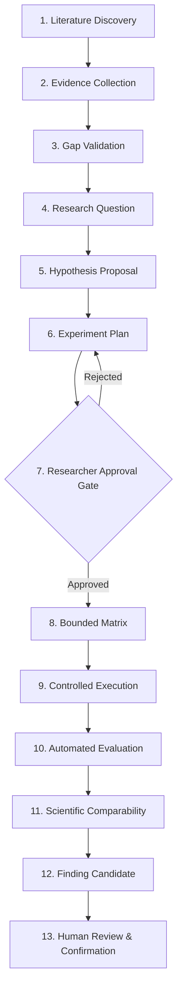

# Research Automation & Guided Scientific Workflows (Phase 15)

## 1. Overview

ResearchLens Phase 15 establishes an automated, evidence-grounded research pipeline connecting literature intelligence to empirical execution and researcher review without breaking existing architecture or removing human oversight.

## 2. 13-Stage Research Lifecycle

### Stage Details

1. **Literature Discovery (`LITERATURE_DISCOVERY`)**: Queries stored and external papers relevant to the topic.
2. **Evidence Collection (`EVIDENCE_COLLECTION`)**: Ingests evidence bookmarks, quotations, sections, and page numbers.
3. **Gap Validation (`GAP_VALIDATION`)**: Validates candidate gaps using `LiteratureGapValidator` (`CONFIRMED_OPEN_GAP`, `POTENTIALLY_ADDRESSED`, `UNVERIFIED`).
4. **Research Question (`RESEARCH_QUESTION`)**: Formulates testable questions grounded in confirmed gaps.
5. **Hypothesis Proposal (`HYPOTHESIS_PROPOSAL`)**: Proposes testable hypothesis with explicit assumptions, missing evidence, measurable criteria, and baseline requirements. Emits `SCIENTIFIC_INTEGRITY_NOTICE`.
6. **Experiment Plan (`EXPERIMENT_PLAN`)**: Generates structured `ExperimentPlan` with backend configuration.
7. **Researcher Approval Gate (`RESEARCHER_APPROVAL`)**: Mandatory authorization gate. Requires `RESEARCHER` or `OWNER` role. Rejects autonomous or unapproved execution.
8. **Bounded Experiment Matrix (`EXPERIMENT_MATRIX`)**: Generates Cartesian parameter combinations enforcing `MAX_RUNS <= 20`.
9. **Controlled Execution (`CONTROLLED_EXECUTION`)**: Executes runs via `LOCAL`, `DOCKER`, or `REMOTE` backends with resource and timeout controls.
10. **Evaluation (`EVALUATION`)**: Computes metrics and serializes `evaluation.json` output contract.
11. **Scientific Comparability (`SCIENTIFIC_COMPARABILITY`)**: Validates task and dataset comparability. Prohibits claiming statistical significance without multi-seed testing.
12. **Finding Candidate (`FINDING_CANDIDATE`)**: Synthesizes empirical deltas, baseline comparisons, limitations, and sets status to `PENDING_RESEARCHER_REVIEW`.
13. **Human Review (`HUMAN_REVIEW`)**: Formal review by an authorized reviewer producing confirmed findings or revision requests.

## 3. Scientific Integrity Guarantees

$$\text{EXECUTED} \neq \text{REPRODUCED} \neq \text{EVALUATED} \neq \text{COMPARABLE} \neq \text{RESEARCH FINDING} \neq \text{SCIENTIFIC CONCLUSION}$$

- **No Autonomous Execution**: All execution pipelines are blocked until explicit human approval.
- **No Unrestricted Swarms or Loops**: Parameter spaces are bounded to 20 runs.
- **No Fabricated Significance**: Single-run improvements do not claim statistical significance.
- **Transparent Provenance**: Every proposal and finding links to exact literature quotations, page numbers, and run IDs.
